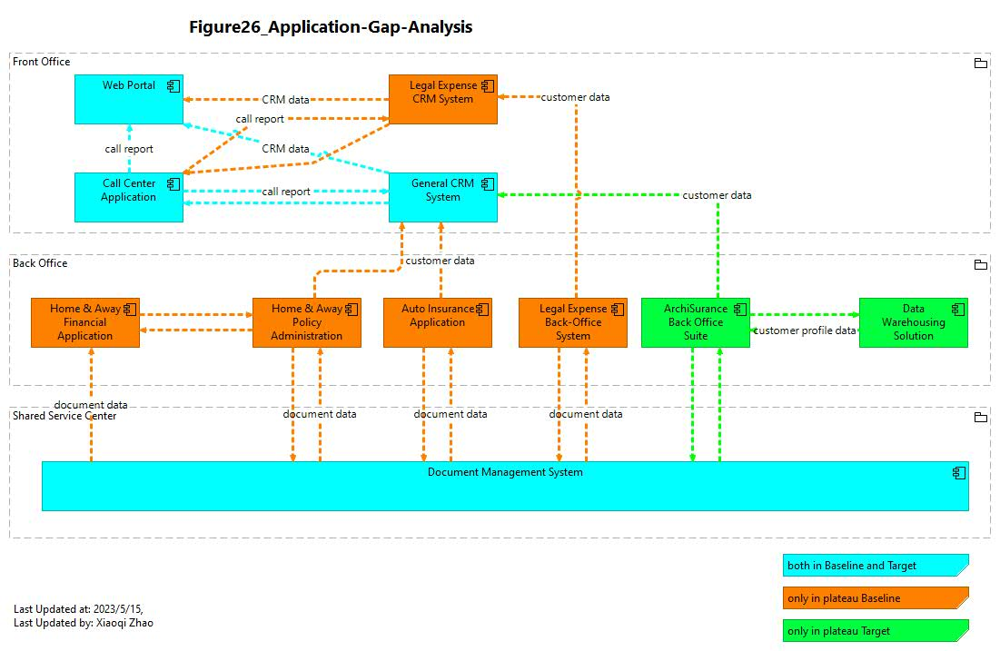

# 🏛️ ArchiSurance Mastery: Hands-on ArchiMate Practice

[](https://www.opengroup.org/archimate-forum/archimate-32-standard)
[](https://www.archimatetool.com/)
[](https://www.udemy.com/course/archi-archimate-modeling-practices-with-archisurance/?referralCode=5391DBF946B5C02FFF7D)
[](https://www.udemy.com/course/archi-archimate-modeling-practices-with-archisurance/?referralCode=5391DBF946B5C02FFF7D)
[](https://opensource.org/licenses/MIT)

> **The ultimate hands-on tutorial for aspiring Enterprise Architects.** This repository provides a complete ArchiMate implementation of the famous **ArchiSurance** case study, specifically designed for candidates preparing for the **ArchiMate® Practitioner (Level 2) Certification Exam.**

---

## 🎯 Why This Repository?

Theory is one thing; application is another. To pass the ArchiMate Practitioner exam, you must understand how to apply the language to complex, real-world scenarios. 

**ArchiSurance** is the official case study used by The Open Group. This repository transforms that case study into a "Hands-on Lab," allowing you to explore, modify, and learn the relationships between Business, Application, and Technology layers.

### ✅ Key Learning Objectives:
* **Layer Interaction:** Master how the Business Layer drives Application requirements.
* **Cross-Layer Mapping:** Understand the derivation of relationships (Serving, Realization, Assignment).
* **Strategy & Motivation:** Learn to model Drivers, Goals, and Outcomes (crucial for Level 2).
* **Implementation & Migration:** Practice Gaps, Plateaus, and Work Packages for transition planning.

---

## 📂 Repository Structure

The models are organized to follow the standard ArchiSurance transformation journey:

| Folder / File | Description | ArchiMate Focus |
| :--- | :--- | :--- |
| `📦 ArchiSurance_Full_Model.archimate` | The complete, end-to-end model. | All Layers |
| `📁 01-Motivation` | Stakeholder analysis and drivers for change. | Strategy & Motivation |
| `📁 02-Business-Layer` | Business processes, functions, and actors. | Business Architecture |
| `📁 03-Application-Layer` | Component realization and service exchange. | Information Systems |
| `📁 04-Technology-Layer` | Infrastructure, Nodes, and System Software. | Technology Architecture |
| `📁 05-Migration` | Roadmap from Baseline to Target architecture. | Implementation & Migration |

---

## 🚀 Getting Started (Hands-on Practice)

To get the most out of this practice guide, follow these steps:

1.  **Install Archi:** Download the latest version of [Archi](https://www.archimatetool.com/), the industry-standard open-source modeling tool.
2.  **Clone the Repo:** 
```bash
git clone [https://github.com/yasenstar/ArchiSurance_Practice.git](https://github.com/yasenstar/ArchiSurance_Practice.git)
```
4.  **Open the Model:** Launch Archi and open the `.archimate` file.
5.  **Reverse Engineer:** Look at a view (e.g., "Business Process View") and try to recreate it from scratch using the ArchiSurance case study PDF (not included, available via The Open Group).

---

## 🏆 Exam Preparation Tips (Level 2)

This repository emphasizes the areas most likely to appear on the **ArchiMate Practitioner Exam**:

* **Relationship Strength:** Understand why a *Realization* is used over an *Assignment*.
* **Grouping vs. Composition:** Learn when to use structural vs. grouping elements.
* **Derived Relationships:** Practice the "short-cut" rules for complex paths.
* **Viewpoint Choice:** Learn which viewpoint is best for specific stakeholders (e.g., Layered Viewpoint vs. Application Usage Viewpoint).

---

## 🖼️ Preview



---

## 🎓 Master ArchiMate with Top-Rated Training

This repository is the official companion to my globally recognized ArchiMate training series. Whether you want a guided deep-dive or free community resources, these links are the best place to start:

### ⭐ [Bestseller] ArchiMate Modeling Practices with ArchiSurance
This course is a **long-standing Bestseller** on Udemy and has been officially selected for **Udemy Business**, reflecting its high quality and trust among global enterprises. It is specifically designed to help you bridge the gap between Level 1 theory and Level 2 practical application.
* **[Enroll in the Bestselling Udemy Course Here](https://www.udemy.com/course/archi-archimate-modeling-practices-with-archisurance/?referralCode=5391DBF946B5C02FFF7D)**

### 📺 Free Community Sharing (YouTube)
I believe in giving back to the ArchiMate modeling community. You can access a dedicated playlist of tutorials for free to get started with the ArchiSurance case study.
* **[Watch the Free YouTube Series](https://www.youtube.com/playlist?list=PL6DEHvciXKeXj1IlGBRB0KMaSv5Xt38uk)**

---

## 🎯 Why This Practice Lab?

To pass the ArchiMate Practitioner exam, you don't just need to know the definitions—you need to know how to **model**. ArchiSurance is the official case study used by The Open Group, and this repository provides the "Digital Twin" of that case study.

### Key Features:
* **Level 2 Exam Focus:** Heavy emphasis on the Motivation, Strategy, and Implementation & Migration layers.
* **Relationship Mastery:** Hands-on examples of derived relationships and complex cross-layer mapping.
* **Real-World Scenarios:** From baseline architecture to target state plateaus.

---

## 🛠️ Requirements

1. **The Archi Tool:** You will need [Archi](https://www.archimatetool.com/) (the leading open-source ArchiMate modeling tool) to open the `.archimate` files.
2. **Case Study Document:** It is recommended to have the ArchiSurance Case Study PDF (from The Open Group) open as you explore these models.

---

## 🤝 Contributing & Community

Contributions are welcome! If you find a relationship that could be modeled more efficiently or want to add a new viewpoint (e.g., Security or Data), feel free to:
1. Fork the Project.
2. Create your Feature Branch.
3. Commit your Changes.
4. Open a Pull Request.

## ⭐ Support


**If this repository helps you on your path to becoming a certified ArchiMate Practitioner, please give it a ⭐!** It helps others find this resource.

---
*Disclaimer: ArchiMate® is a registered trademark of The Open Group. This repository is a community-driven practice guide and is not officially affiliated with The Open Group.*